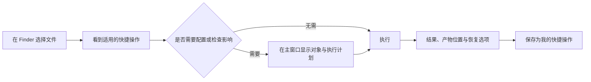

# 妙右产品体验审核与重构建议

日期：2026-11-18。代码基线：`47aa0ff`。

Method: dual-agent (A: /root/product_review · B: /root/behavior_evidence)，主代理补充原生界面观察与证据复核。

## 结论

妙右最需要建立的是一条可靠的文件任务流程。用户选中了什么、现在能做什么、运行会改变什么、结果在哪里，这四件事应当始终清楚。

现有能力值得保留，但主窗口首先让人配置一个菜单系统。用户需要理解动作启停、场景分类、顶层位置、扩展状态、文件夹范围、步骤输入输出，才能完成原本很具体的事情。能力数量增加时，这些理解成本还会继续上升。

这次发现的菜单遗漏、确认保护和诊断问题，也会把本来正常的使用变成反复排查。先修复这些信任断点，再重做主流程与信息架构，收益高于直接更换配色、卡片或窗口布局。

建议定位为：**在 Finder 中就地完成日常文件事务的助手**。围绕整理、转换和分享准备建立核心体验；自定义步骤作为重复任务的进阶入口；剪贴板成为独立选择启用的伴随能力。

## 证据范围与限制

- 阅读了主窗口、工作台、动作编辑器、设置、Finder 菜单、执行器、组合引擎、剪贴板和共享模型等主要路径。
- 观察了原生主窗口与设置页。主窗口显示 `23/105 已启用`，以动作磁贴和固定菜单预览并排呈现；最小窗口宽度为 1120。设置把语言外观放在最前，Finder 扩展配置排在较后的位置。
- 实机复核到 `MiaoRightFinder` 进程正在运行，而状态检测查询旧名称 `MiaoRightExtension`，界面显示“已启用，建议重启 Finder”。
- 未执行删除、移动、重命名等真实文件操作。相关风险来自调用链审查，不能当作已复现的数据丢失事故。
- 没有做用户访谈、任务耗时测量、完整 VoiceOver 测试或性能基准。下面的分数是专家启发式判断；路线、默认能力集合和界面草图属于提案。
- Web detector 对 `Sources` 运行一次，返回 `[]`、退出码 0。其扫描不覆盖 SwiftUI；这不能解释成程序没有设计问题。原生界面与源代码是本次有效证据。

## 需要优先处理的五类问题

### 1. [P1] 配置结果与实际可用能力不一致

**代码事实。** 新组合动作默认保存到 `__top__`，Finder 只把分类为 `nil` 的动作放在顶层，其余只遍历预定义场景。默认分组模式下，顶层自建动作缺少渲染分支。关闭常用置顶时，常用名仍被预先从其他分组排除，随后常用块又不生成，会遗漏这些动作。

主窗口的“实时”预览有另一套算法，主要从内置目录生成，不完整反映自建动作、用户修改的分类、适用文件和菜单设置。界面固定写着“下载文件夹中右键 3 个文件”，并未真正对那三个文件求得菜单。

**影响。** “开关开了但 Finder 找不到”会让人怀疑授权、目录配置和扩展状态。错误预览又会把排查方向带偏。

**建议。** 让 Finder 和预览使用同一份菜单计划，明确区分“已添加到菜单”“适用于当前选择”“已被 Finder 加载”。未知分类必须有可见的回退位置。菜单模拟器允许选择文件、文件夹、空白处与多选样本，并解释某项为什么隐藏。

依据：[新动作保存](/Users/oliver/workspace/myself/MiaoRight/Sources/MiaoRightKit/Views/ComposedActionEditorView.swift:389)、[顶层键](/Users/oliver/workspace/myself/MiaoRight/Sources/MiaoRightKit/ScriptStore.swift:363)、[Finder 分类和常用过滤](/Users/oliver/workspace/myself/MiaoRight/Sources/MiaoRightFinder/FinderSync.swift:140)、[分组渲染](/Users/oliver/workspace/myself/MiaoRight/Sources/MiaoRightFinder/FinderSync.swift:184)、[预览实现](/Users/oliver/workspace/myself/MiaoRight/Sources/MiaoRightKit/Views/StudioView.swift:483)。

### 2. [P1] 执行保护与结果传递不够可信

**代码事实。** 编辑器写着“含破坏性步骤·执行前确认”，但“试运行”选完文件后直接执行管道，绕过 Finder 请求入口的确认。管道本身没有统一确认门。`builtin.run` 一律标为非破坏性，包装具有副作用的内置操作时无法正确推导风险。

另外，兼容性检查在执行到每一步时才发生。前一步可能已修改文件，后一步才发现输入类型不合适。内置包装器通过扫描输入文件父目录、比较修改时间来猜测产物；它也会吞掉部分脚本失败，将空描述转成“已调用”。这会削弱组合动作的可预测性。

**影响。** 用户无法放心试验，也很难判断一次“完成”到底改了哪些文件。后续步骤可能拿到无关文件或过期路径；这些具体链路仍应在临时样本上复现。

**建议。** 所有入口统一经过“校验 → 影响计划 → 必要确认 → 执行”。将“仅检查配置”和“真实执行”分开。临时副本试跑只适用于能够隔离的文件操作；打开应用、发送消息、运行任意脚本等外部副作用不能被虚假承诺为安全试跑。每个动作必须明确返回产物、修改项、跳过项和错误，停止猜产物。失败要显示停在哪一步、前面已经完成什么，以及哪些变动可以恢复。

依据：[试运行](/Users/oliver/workspace/myself/MiaoRight/Sources/MiaoRightKit/Views/ComposedActionEditorView.swift:403)、[管道执行](/Users/oliver/workspace/myself/MiaoRight/Sources/MiaoRightKit/Composer/PipelineEngine.swift:49)、[内置包装风险声明](/Users/oliver/workspace/myself/MiaoRight/Sources/MiaoRightKit/Composer/AtomicOperation.swift:462)、[产物追踪与失败处理](/Users/oliver/workspace/myself/MiaoRight/Sources/MiaoRightKit/Composer/BuiltinRunner.swift:8)、[正常入口确认](/Users/oliver/workspace/myself/MiaoRight/Sources/MiaoRightKit/ScriptExecutor.swift:288)。

### 3. [P1] 剪贴板的产品边界与控制不清楚

**代码事实。** 启动 App 就开始轮询和持久化剪贴板。设置里的“悬浮面板”只控制窗口显示，没有停止历史记录的含义。自动粘贴未获得辅助功能授权时可以静默返回。

**影响。** 用户可能把“关闭面板”理解为“停止记录”。从一个 Finder 工具进入跨应用内容记录，也需要清楚的功能选择。这里没有发现向外传输或遥测的证据，问题在本地记录范围与控制方式。

**建议。** 独立提供“记录剪贴板历史”开关、“暂停记录”和“显示面板”。首次启用时说明本地保存的内容及保留方式。增加保留期限、来源排除和清理入口；密码管理器等明确声明保密或短暂内容的来源应优先验证排除策略。复制与自动粘贴分别反馈，未授权时告诉用户“已复制，可按 ⌘V 粘贴”，并给出授权入口。

刚修好的搜索输入、列表选择、自动收起、固定和多屏裁剪应继续保留，不应重构后退回原来的按键冲突。

依据：[启动记录](/Users/oliver/workspace/myself/MiaoRight/Sources/MiaoRightApp/MiaoRightApp.swift:170)、[设置中的面板开关](/Users/oliver/workspace/myself/MiaoRight/Sources/MiaoRightKit/SettingsView.swift:208)、[未授权自动粘贴](/Users/oliver/workspace/myself/MiaoRight/Sources/MiaoRightKit/ClipboardHistoryService.swift:263)。

### 4. [P2] 主窗口以配置为中心，首次成功和结果反馈薄弱

**观察与代码事实。** 默认进入工作台，主体是三列动作磁贴、分类调整和菜单预览，“新建菜单”是明显的主按钮。首次需要的 Finder 扩展激活却在设置后半部分。执行结果主要依赖通知和最后一次结果，没有面向用户的完整任务记录页。

**影响。** 想转换照片的人先看到几十个开关；想重复整理文件的人先面对空白步骤编辑器。成功后又缺少稳定位置查看产物和部分失败。

**建议。** 初次启动只带用户完成一次无害操作：启用扩展、确认作用范围、在 Finder 试用、看到结果。成熟使用阶段，主窗口负责我的快捷操作、任务发现和运行记录。菜单配置成为明确的管理页面，预览作为辅助工具按需展开。高频任务从模板或具体对象起步，再逐步增加步骤。

依据：[默认主窗口](/Users/oliver/workspace/myself/MiaoRight/Sources/MiaoRightKit/ContentView.swift:16)、[工作台布局](/Users/oliver/workspace/myself/MiaoRight/Sources/MiaoRightKit/Views/StudioView.swift:27)、[设置排序](/Users/oliver/workspace/myself/MiaoRight/Sources/MiaoRightKit/SettingsView.swift:27)、[结果记录方式](/Users/oliver/workspace/myself/MiaoRight/Sources/MiaoRightKit/ScriptExecutor.swift:346)。

### 5. [P2] 搜索、状态和视觉层级增加了不必要的判断

**代码事实。** 工作台搜索只查存储名称；动作显示名却可能已翻译成英文。设置页搜索承诺“菜单、设置”，结果只查内置动作，点击行会切换启用状态。同一搜索面板还在标题栏的两处被构建。扩展进程检测继续查询旧进程名。

**界面观察。** 多种渐变、彩色边框、emoji 图标、分类徽标、状态胶囊和大量同等大小的卡片同时争夺注意力。“顶层”属于菜单实现概念，对完成文件任务帮助有限。设置很长，用户需要记住所需选项在什么位置。

**建议。** 搜索统一覆盖显示名、别名、动作说明、自建操作和设置。每个结果明确显示将执行、打开详情还是修改配置；切换开关使用显式控件。状态检查对准真实扩展身份，并提供可操作的诊断。视觉用系统字体、明确选中态和少量强调色建立层次；彩色只服务状态、文件类型和主要动作。

依据：[工作台过滤](/Users/oliver/workspace/myself/MiaoRight/Sources/MiaoRightKit/Views/StudioView.swift:287)、[主搜索与两处面板](/Users/oliver/workspace/myself/MiaoRight/Sources/MiaoRightKit/ContentView.swift:78)、[搜索数据源](/Users/oliver/workspace/myself/MiaoRight/Sources/MiaoRightKit/ContentView.swift:247)、[旧进程名](/Users/oliver/workspace/myself/MiaoRight/Sources/MiaoRightKit/ExtensionStatusService.swift:54)。

## 已经做对的事情

1. Finder 就地执行、按文件条件过滤，直接利用用户当前选中的对象。这是核心优势。
2. 把 App 或文件夹拖进去生成操作，比先学习脚本和参数更容易理解。
3. 线性步骤编辑器比任意节点画布更适合大多数顺序任务；应继续强化可读性和即时校验。
4. 原生能力、共享存储、请求认领去重和剪贴板 SQLite 有可复用基础。架构调整应围绕可信契约，而非为了统一技术重新实现全部能力。

## 启发式评分

0 为最差，4 为最好。此表来自独立产品评审，未把专家评分当作真实用户测试数据。

| 项目 | 分数 | 主要依据 |
|---|---:|---|
| 状态可见 | 2 | 有状态与通知，但诊断和预览不可靠，缺少持久结果闭环 |
| 与现实匹配 | 3 | 文件操作具体；顶层、监控、输入输出增加术语成本 |
| 控制与自由 | 1 | 试运行保护与历史记录控制不足，编辑草稿退出保护薄弱 |
| 一致与标准 | 1 | Finder、预览、搜索使用不同规则 |
| 错误预防 | 1 | 有确认基础，入口和包装调用存在缺口 |
| 识别代替记忆 | 2 | 有说明和分类，但需要记住能力位置、适用条件与状态 |
| 灵活与效率 | 3 | 右键、批处理、快捷键和剪贴板键盘操作有价值 |
| 简洁 | 2 | 顶层导航不多，但首屏承载的决策类型过多 |
| 错误恢复 | 1 | 缺少部分成功、结果定位和受支持的恢复操作 |
| 帮助与文档 | 2 | 有说明，首次成功和关键决策点的帮助不足，部分文档已落后实现 |
| **合计** | **18/40** | 优先解决可信度与任务闭环 |

## 从零重新定义产品

### 三种方向及取舍

| 方向 | 好处 | 代价 | 判断 |
|---|---|---|---|
| 精简菜单管理器 | 改动较小，保留现有心智 | 用户仍需先配置，结果闭环改善有限 | 可以作为过渡版本 |
| Finder 文件任务助手 | 贴近整理、转换、分享的真实需求；能力能逐步发现 | 需要统一上下文、执行计划和结果模型 | **推荐方向** |
| 全能桌面自动化平台 | 理论能力边界更广 | 权限、状态、编辑器、排错与学习成本迅速增加 | 当前不建议扩大到此范围 |

### 核心路径



不要求所有动作先开主窗口。复制路径、用应用打开等轻量操作继续就地完成；批量重命名、格式转换和跨目录整理等需要选择参数或检查影响时，再进入主窗口详情区。

### 右键菜单的职责

- 保留用户明确固定的少量动作，位置稳定。起步可以用 4–6 项作为原型规模，最终数量由任务验证决定。
- 根据当前选择只展示真正适用的动作；无法判断时宁可解释条件，也不要执行到一半才报错。
- “最近使用”单独成区，避免使用频率不断挤动用户固定的位置。
- 使用“更多操作…”承接长尾能力，将当前选择一起交给主窗口；文件上下文来自这次右键，不猜测 Finder 此刻可能选中了什么。
- “转成…”只在格式可转换时出现，进入统一参数页；“永久删除”等危险操作不放在默认一级入口。

### 主窗口的建议结构

采用带文字的原生侧栏，先做三个清楚的页面，设置使用标准入口。剪贴板在启用后提供独立入口。

| 页面 | 回答用户的问题 | 主要内容 |
|---|---|---|
| 我的快捷操作 | 我常用的事情在哪里？ | 固定顺序、编辑配方、少量最近使用；菜单预览按需展开 |
| 发现操作 | 这个任务能不能做？ | 用任务名称搜索，展示整理、转换、分享等配方；高级能力按需展开 |
| 运行记录 | 刚才到底做成没有？ | 运行中、完成、部分完成、失败；文件列表、产物位置、恢复入口 |

从 Finder“更多操作…”或拖入文件进入时，窗口直接打开任务详情，在顶部持续显示文件数量、类型、来源和目标目录。没有文件上下文时给出拖放区与选择文件按钮，避免显示一个无法执行的“运行”按钮。

可供原型验证的任务详情示意，以下文件与数值均为虚构：

```text
准备发送图片
已选 8 张图片 · 来自“下载”

格式      JPG
大小      保持原尺寸
隐私      移除位置资料
保存位置  原文件夹 / 分享用图片

执行后将新建 8 张图片，保留原件。
存在同名文件时另存新名称。

                    [查看变化] [开始处理]
```

完成后把这一块换成实际结果，例如“成功 7 项，失败 1 项”，给出“在 Finder 中查看”“查看失败原因”“保存这套操作”。不能只显示一个绿色完成图标。

### 自定义流程的入口

先选择具体配方：移动到固定文件夹、用指定应用打开、转换后归档、压缩后准备分享。配方能直接运行，用户修改参数后就可保存。

只有点击“添加下一步”时才引入步骤编排。步骤标题尽量是“转成 JPG”“保存到照片归档”，并持续显示当前处理原件还是副本、下一步将收到什么。系统只推荐兼容步骤；高级用户仍可查看完整能力目录。

返回时保护未保存草稿。保存前校验名称、必填参数、全链输入输出和目标可访问性。取消一个参数选择器应当保持草稿，不触发运行。

### 剪贴板的边界

作为可选伴随工具启用，具有独立的记录开关和快捷键。临时面板默认点外部收起；固定模式服务连续复制。搜索输入与列表操作继续分离，支持多屏和输入法。

文本、图片、文件路径合并的限制要清楚显示。例如多选包含图片而当前合并只支持文本时，应解释并提供处理方式，避免悄悄跳过图片。用户关闭历史记录后应真正停止采集，已经保存的历史是否保留另行选择。

## 架构应该怎样服务上述体验

建议继续采用一个 macOS App 与 Finder 扩展，不急于拆成多个服务或引入全新技术栈。重构重点是统一语义与状态。

| 边界 | 新契约 | 解决的问题 |
|---|---|---|
| 动作目录 | 稳定 ActionID、显示名/别名、适用条件、参数 schema、风险与输出声明 | 避免中文名称同时充当执行身份、显示文本和迁移键 |
| 当前对象 | SelectionContext：来源、文件 URL、类型与数量、授权信息 | 所有入口知道这次处理什么；不用共享可变的“上次选择” |
| 菜单计划 | MenuPlan：统一适用性、固定位置、常用区、隐藏原因 | Finder 与主窗口预览完全复用规则 |
| 执行准备 | ExecutionPlan：完整校验、影响清单、嵌套风险、确认要求 | 试跑、右键、自定义操作不会绕过保护 |
| 执行结果 | ActionResult：实际产物、修改项、跳过项、错误、恢复能力 | 不扫描目录猜产物，不吞掉错误 |
| 运行协调 | requestId 队列与 RunRecord 状态 | 连续触发不覆盖；能查看排队、运行、部分完成、失败和取消 |
| 界面状态 | 页面各自拥有搜索、选择、草稿；全局只传显式事件 | 使用记录更新不会不必要地重建整个编辑界面 |

现有文件式 IPC 已有原子认领、锁和去重，值得保留。但单个 `pending_execution.json` 仍是单槽邮箱：在消费者认领前，后来的写入可能覆盖前一次请求。可以先迁移为按 requestId 命名的待处理文件，再提供受理与完成状态；无需为了排队先引入大型服务。

恢复能力必须按动作声明。重命名、移动在条件满足时可记录反向操作；外部应用、分享和任意脚本不能承诺统一撤销。执行中取消应停止尚未开始的步骤，并清楚保留已经完成的变动。

## 实施顺序与验收

### 第一批：先恢复可信度

1. 修复顶层分类和关闭常用置顶后的动作遗漏。
2. 将预览与 Finder 统一到菜单计划，加入自定义动作和选择样本。
3. 把风险求解和确认放到公共执行准备阶段，补上试运行与内置包装路径。
4. 修正扩展进程身份与诊断，避免无依据地推荐重启 Finder。
5. 提供剪贴板记录开关和自动粘贴失败反馈。

验收用例应覆盖：默认分组下新建操作出现；关闭常用后动作回到正常位置；移动分类后预览与 Finder 一致；所有真实副作用入口有同一保护；未授权粘贴明确反馈。上述用例都先用临时文件或无害动作验证。

### 第二批：验证一条完整任务路径

先完成“把几张照片转成适合发送的图片”。让用户看到选择对象、参数、原件保留策略、同名处理、执行进度、实际输出和失败项。随后再验证“将文件整理到固定目录”，检验目标选择和恢复边界。

同时做薄而完整的运行记录，统一单动作与组合动作的结果呈现。暂不把所有长尾动作都重做成复杂页面。

### 第三批：重组主窗口与能力发现

再实施“我的快捷操作 / 发现操作 / 运行记录”，把现有工作台降为菜单管理能力。统一搜索，收窄默认入口，保留高级能力的可发现路径。自定义操作从配方开始，空白编辑器放在进阶入口。

视觉跟随结构收敛：系统字体、稳定侧栏、轻量分隔、清楚的主按钮和错误区域。颜色用于强调状态，减少每张卡片同时使用渐变、描边、徽标和 emoji 的情况。

### 第四批：在真实任务里确认是否更好用

以下是建议的验证任务，不是已经取得的数据：

- 让不熟悉项目的 Mac 用户首次启用并完成一次无害操作，观察是否需要口头解释扩展和文件夹范围。
- 给几张 HEIC 图片，让用户生成适合发送的 JPG，观察是否理解原件与产物位置。
- 让用户创建“移动到某目录”并在 Finder 中找到，观察配置与实际是否一致。
- 故意放入一个无法处理的文件，观察用户能否找到失败原因、成功产物及恢复方式。
- 测试中文输入法、英文界面、键盘导航、VoiceOver、三屏布局和固定剪贴板面板。

记录是否完成、是否需要帮助、误操作及是否能找到产物。先获得基线，再定改善目标；不以启用了多少功能作为易用性的替代指标。

## 典型用户与需要验证的假设

**第一次使用的普通用户。** 最容易卡在“扩展启用后还要不要设置目录”“开关开了为什么菜单没有”。需要一次成功的操作和可信状态，而非更多术语说明。

**反复处理文件的熟练用户。** 更在意固定位置、批量效率、组合是否可靠、失败是否可定位。不要让自动排序破坏肌肉记忆；模板与键盘效率应共存。

**键盘和低视力用户。** 原生 AX 观察中，主导航主要靠图标和帮助文本，磁贴的部分开关表现为无名称按钮。需要实测 VoiceOver 的名称、状态、焦点顺序和缩放，不能据此直接断言完全不可用。

尚未验证的关键假设包括：剪贴板是否是独立核心需求、哪些文件任务最常发生、用户是否愿意管理菜单，以及首批推荐操作应当是哪几项。可以基于用户自愿提供的本地使用记录或任务观察调整，不应为了界面整齐直接删除能力。

## 文档与后续执行

README 与 AGENTS 中仍有节点画布/旧工作流的描述，而当前主窗口是线性组合编辑器。下一轮实施时应同步更新，防止代码、帮助与代理上下文继续分叉。

本次只提交了此前的剪贴板修复，未擅自实施上述产品重构。建议下一次从第一批可信度修复开始；其后用一条完整任务原型验证新方向，再决定主窗口的重做规模。

可采用的工作流顺序是 `$impeccable harden` 处理保护与状态，`$impeccable shape` 明确任务原型，`$impeccable distill` 收敛信息结构，最后 `$impeccable polish` 做视觉与交互收尾。可以分批执行，无需一次性重写全部程序。

Questions skipped: 当前审核范围和普通 Mac 用户定位已明确；未为交付建议中断工作，也未把未验证假设当作实施授权。
